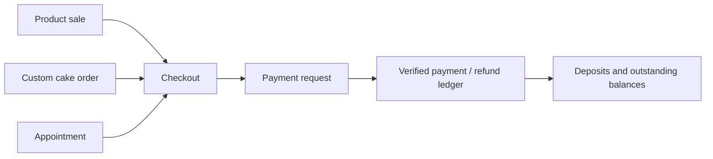

# SERVQO Multi-Industry Architecture — Phase 1

17 November 2026. Builds on the baseline in `SERVQO_CURRENT_STATUS.md`; this document describes the new code, not an already migrated production deployment.

## Scope and compatibility

One application, one merchant boundary, shared Supabase Auth/PostgreSQL/Storage and Drizzle. The existing 19-key website registry, legacy renderer versions, component ownership, draft/publish transactions, POS order lifecycle, idempotency and verified subscription rules remain in place. No cake pre-order, appointment, inventory, staff scheduling or real-payment system is introduced.

The additive migration `drizzle/0005_multi_industry_foundation.sql` is required before this code is deployed. It has not been applied to any external database by this task. Regression tests apply it only to disposable PGlite databases. An unmigrated server fails closed with a database-update message; it does not silently grant default access.

## Business types and starter configuration

`src/lib/business-modules.ts` defines six types: `cafe`, `bakery`, `nail_salon`, `hair_salon`, `beauty_studio`, `other`. `merchants.business_type` is a checked text column defaulting to `cafe`.

- Existing merchants become café merchants without another onboarding step. Existing optional implemented modules are enabled and get a `legacy` included license.
- New café/bakery merchants start with core, builder/media/catalog, product POS, F&B Orders and kitchen queue enabled.
- Other new business types start with shared core, website, media and retail catalog. F&B operational modules are initially disabled but included licenses permit an owner to explicitly enable them for a hybrid retail business.
- No salon gets a functional service checkout or appointment engine. Discovery explicitly describes the existing POS as product pickup with cash/unpaid status.
- `WorkspaceOnboarding` submits the selected type. Server validation rejects unknown types. `initialBusinessLayout` reuses existing component keys, adjusts starter text and hides menu/ordering sections for salon starters. It does not add functional booking/pre-order forms or alter existing layouts.
- Owners can change business type in Store > Business Modules. This changes recommendations only; existing enabled modules, layouts, products, licenses and trial dates are not reset. New page creation still uses the existing generic starter helper; deeper industry content adapters remain future work.

## Module registry and state

`businessModules` is the deployed feature registry. Each entry has key, name, description, category, implementation availability, optional/core flag, dependencies, capabilities, subscription requirement, entitlement class, suggested types, optional navigation metadata and explicitly illustrative monthly pricing. A module without a standalone route has no navigation link. Route configuration remains in the existing `dashboard-navigation.ts`, linked through `moduleKey`.

Implemented keys:

| Category                        | Keys                                 | Behavior                                                                                           |
| ------------------------------- | ------------------------------------ | -------------------------------------------------------------------------------------------------- |
| Core                            | `overview`, `business`, `settings`   | Mandatory shared workspace modules                                                                 |
| Shared optional                 | `website`, `media`, `catalog`        | Existing builder, media and product/menu maintenance                                               |
| Existing F&B/product operations | `pos`, `fnb_orders`, `kitchen_queue` | Existing product pickup POS and staff queue; Orders is the queue route, not another public display |

Coming-soon keys: `customers`, `employees`, `qr_ordering`, `tables`, `cake_preorders`, `cake_customization`, `pickup_schedule`, `production_calendar`, `cake_deposits`, `appointments`, `services`, `staff_availability`, `appointment_calendar`, `service_checkout`, `inventory`, `loyalty`, `multi_outlet`, `analytics`.

Availability and merchant state are separate:

- Availability: `implemented`, `demo` or `coming_soon`. Phase 1 has nine implemented modules and eighteen coming-soon modules; it does not label a planned domain as implemented.
- Effective merchant access: `enabled`, `disabled`, `not_entitled`, `expired` or `coming_soon`.
- Role capability is a separate gate; a licensed module does not grant a role permission.
- Existing subscription access is another separate write gate. A module license never fabricates a paid base subscription.
- `moduleAccess` resolves dependencies recursively and fails closed for missing/cyclic configuration. The server also checks the deployed definition and DB availability.

Dependencies: `media -> website`; `pos -> catalog`; `fnb_orders -> catalog`; `kitchen_queue -> fnb_orders -> catalog`. Future dependencies are declared but cannot activate. Disabling a dependency while an effective dependent module is enabled is rejected; the owner must disable dependents first. Enabling a dependent requires its prerequisites first. No destructive cascade removes module data.

## Three distinct entitlement concepts

| Concept                  | Storage                                                            | Enforcement / purchase status                                                                                                                                                                   |
| ------------------------ | ------------------------------------------------------------------ | ----------------------------------------------------------------------------------------------------------------------------------------------------------------------------------------------- |
| Website design ownership | Existing `merchant_entitlements` and `store_products`              | Existing preview/demo unlock; one-time design pricing remains illustrative USD. Existing unlocks are preserved. No payment collected.                                                           |
| Business module license  | New `business_module_entitlements` and definition pricing metadata | Separate functional access; included/legacy foundation licenses now; provider/admin provenance supported for future trusted integration. No merchant-side license-issuing or checkout endpoint. |
| Base SERVQO subscription | Existing `merchant_subscriptions`, plans, immutable trials/events  | Existing trial/verified-active write gates remain authoritative. Upgrade/manage remains a demo notice.                                                                                          |

Business module prices are discovery examples (currently RM29/month for planned modules), not billing agreements. Included implemented modules have no invented transaction/payment record. Future real recurring pricing needs currency/provider product identifiers, payment verification, webhook idempotency and audit events. The foundation `pricing` JSON column is not a payment ledger.

Website Design Store discovery remains the editor's existing header/hero/gallery/menu/footer layout selectors and demo unlock dialog. Complete themes are a future offering; no complete-theme purchase or functional standalone design checkout is claimed.

## Additive database changes

`src/db/schema.ts`, migration 0005 and its Drizzle snapshot add three tables, bringing the application from 22 to 25 tables:

| Table                          | Columns / constraints                                                                                                                      |
| ------------------------------ | ------------------------------------------------------------------------------------------------------------------------------------------ |
| `business_module_definitions`  | Text key PK, available flag, separate pricing JSON. Registry availability and DB availability must both permit access.                     |
| `merchant_modules`             | UUID PK, merchant FK, module-definition FK, enabled flag, unique merchant+module.                                                          |
| `business_module_entitlements` | UUID PK, merchant FK, module-definition FK, source checked to included/legacy/provider/admin, optional expires_at, unique merchant+module. |

No existing tables are duplicated. No existing business/order/design/media rows are deleted. Existing merchant role rows with `editor` are explicitly migrated to `legacy_editor` to preserve their prior broad access. No other current role assignments change. A merchant-insert trigger initializes only implemented module configuration and included licenses using the selected type. Existing rows are backfilled once by the migration.

The migration also defines SQL capability/module helpers and RLS for the new tables. `supabase/policies.sql` tightens browser content and storage policies using those helpers. The existing migration command applies SQL migrations, the supplemental policy file and catalog registration; running generated SQL alone is not the complete rollout.

There is no module self-purchase/grant action. `configureModule` only updates a configuration row backed by an existing valid license. The server locks the merchant, evaluates dependencies, rejects future/core modules and applies merchant-scoped updates. `setBusinessType` is owner-only and does not toggle modules.

## Authorization model

`merchant-capabilities.ts` defines read/write distinctions. `authorize` validates identity, merchant membership, role capability and mapped module access before returning. Critical action subscription checks remain separate.

| Role          | Phase 1 policy                                                                                                                               |
| ------------- | -------------------------------------------------------------------------------------------------------------------------------------------- |
| Owner         | All defined capabilities, including module configuration and export                                                                          |
| Manager       | Existing broad operations/builder/reporting access, no module configuration                                                                  |
| Legacy Editor | Same broad prior feature access, explicitly migrated; no new module-management privilege                                                     |
| New Editor    | Website/media editing, design selection/demo unlock, basic workspace/business read; no POS, financial report, export or module configuration |
| Cashier       | Workspace/business/catalog read and product POS; no menu writes, website data or full export                                                 |
| Kitchen       | Workspace/business read, order queue read/write; no POS submission, builder or catalog read                                                  |
| Technician    | Basic workspace/business read only; does not imply implemented scheduling/service operations                                                 |
| Unknown       | No capabilities; root dashboard is also denied                                                                                               |

New role names are foundation definitions, not an employee invitation or role-assignment product. There is no untrusted role update action. Platform `admin` stays separate and uses its existing profile guard.

Browser content policies now enforce capabilities/module configuration for pages/websites/sections/revisions/design ownership/media/menu/order tables. Website editors may read products as renderer content even when they cannot operate the POS or edit the catalog. Global deployed design catalog remains readable; merchant/identity/configuration/subscription metadata retains tenant/self read policies. Browser application-table writes remain revoked, including module configuration and license writes. Storage INSERT requires media/menu write capability, relevant module and subscription; DELETE requires media write capability, module and subscription. The bucket remains public for marketing images; read protection does not make image URLs confidential.

Privileged server SQL can bypass RLS, so explicit server authorization and tenant predicates remain essential. SQL role capability mappings and module dependency mappings must be updated alongside the TypeScript registry when future roles/modules ship. SQL `has_business_module` includes transitive dependencies for currently implemented modules; future ones require reviewed SQL support before activation.

Export uses a dedicated `data:export` capability and keeps read-only access after base subscription expiry; it includes module configuration/licenses but not image binaries. Order queue read remains possible after base subscription expiry if the module remains enabled/licensed. Existing mutation policy still blocks new orders and preparation/completion after subscription expiry while cancellation/acknowledgement remain allowed.

Larger changes requiring separate review: replacing legacy editors with least-privilege assignments per business, private customer media, forced RLS/dedicated runtime DB roles, full audit trails for license/configuration changes, resource-specific permission overrides and real billing providers. Do not silently remove prior staff access during this rollout.

## Dashboard loading and navigation

`loadMerchantContext` authenticates, selects membership, checks route permission/module access, and loads merchant/subscription/configuration. It contains no pages, media or design-price reads. `dashboardLoadPlan` selects only the datasets needed by the current view; `dashboardData` executes the selected tenant-scoped reads.

| View                                        | Module-specific datasets                                                                                                                                  |
| ------------------------------------------- | --------------------------------------------------------------------------------------------------------------------------------------------------------- |
| Overview                                    | Pages/catalog/design ownership for website-capable roles; products for catalog/website-capable roles; overview metrics remain a separately guarded action |
| POS                                         | Products and categories; ticket sync remains the existing API                                                                                             |
| Orders                                      | None from builder/menu; dedicated orders API retrieves tickets                                                                                            |
| Menu Management                             | Products and categories                                                                                                                                   |
| Editor / Preview                            | Pages, products, deployed design catalog/prices/ownership; media only if media module/read permission allows                                              |
| Pages                                       | Pages only                                                                                                                                                |
| Media Library                               | Media only                                                                                                                                                |
| Business / General / Billing / Module Store | Shared merchant/subscription/configuration only                                                                                                           |

No subscription/license failure is bypassed with a timer. Existing route loading/error UI stays; module-disabled/permission failures have safe explanatory messages. Orders API returns a safe 403 for unavailable modules. POS treats that rejection as definite (rather than leaving a bill in uncertain network state).

Client navigation now uses App Router navigation so each view loads its own server data. Existing deep links stay valid. Previous category/design-store aliases redirect to supported screens; `/dashboard/store/modules` is module discovery/configuration and `/dashboard/store/designs` redirects into the existing editor design experience.

One shared sidebar filters implemented navigation by enabled/effectively licensed module and capability, and shows relevant bakery/salon plans as disabled coming-soon entries. The website group uses a neutral label. Business type is a recommendation, not an authorization restriction.

`MerchantWorkspaceProvider` retains working and saved layout baselines across routes so unsaved content and unload warnings survive navigation to a light-data module. POS tab/session drafts remain unchanged. Preview buttons on a view without builder data navigate to the protected Preview route instead of opening an empty local preview. A route refresh does not become a refresh loop.

The dashboard client component remains shared and the Overview still uses builder data for its existing website snapshot. This is an incremental isolation step, not a full server-component dashboard rewrite or independent industry apps.

## Future shared checkout — design only

Keep operational documents separate:

A future checkout takes typed line references (product/service/custom-order/appointment), authoritative price snapshots, currency and merchant/outlet context. A separate ledger records payment attempts, provider references, settled payments, allocations/deposits and refunds with idempotency and audit trails. Appointment resource locks/statuses belong in a booking module, not `pos_orders`. A custom cake quote/production schedule likewise owns its own lifecycle.

Completing a POS order is an operational status change, not proof of payment. The overview figure is now labeled **Completed order totals**; it still sums gross completed order totals including unpaid tickets in the Malaysian calendar month. It is not collected revenue, net revenue or a financial ledger. No financial integration or invented collection calculation ships in Phase 1.

## Future Website Builder adapters — design only

Preserve `WebsiteRenderer`, the 19 component keys and existing version lookup. Introduce versioned content adapters later: café menu/featured products; bakery cake catalog and a separately authorized pre-order module; salon service catalog/staff profiles and separately authorized booking module. Read adapters can feed trusted renderer props; write forms must call domain services with their own validation/capabilities/license checks. A storefront section must never activate a missing operational module simply because its key appears in a dropdown.

## Deployment and approval boundary

1. Review migration 0005, the role mapping, initialization/backfill policy and the `supabase/policies.sql` changes. Confirm no current custom role needs a separate approved policy.
2. Back up the target database using the existing operational process; test the exact migration command on a staging Supabase project first. Validate table/policy/function definitions, legacy editor behavior, existing websites, onboarding, subscription expiry, storage and two-device POS.
3. An authorized operator may then run `npm.cmd run db:migrate` with the correct direct/session `MIGRATION_DATABASE_URL`. This task does not grant itself production migration approval and has not run that command. It already applies the policy file and catalog registration; do not run seed or reset commands for this rollout.
4. Coordinate migration and code deployment: **do not deploy this code against the old 22-table schema**. RLS changes need to land with role-policy code, and SQL helper functions must exist before applying the updated supplemental policies. Avoid a mixed-version deployment window for editor-role migration.
5. Verify hosted auth/cookies, public sites, owner/new-editor/legacy-editor/cashier/kitchen boundaries, disabled module deep links/API calls, storage permissions, and actual devices after deployment.

Rollback should favor a forward correction or coordinated known-compatible release. Do not drop new tables or revert role names blindly after deployment; do not reset trial, content or design ownership. Existing source baselines must be reviewed for compatibility with migrated role values before rolling back application code.

No production readiness, live payment or two-device acceptance claim is made from mocked services or PGlite tests.
